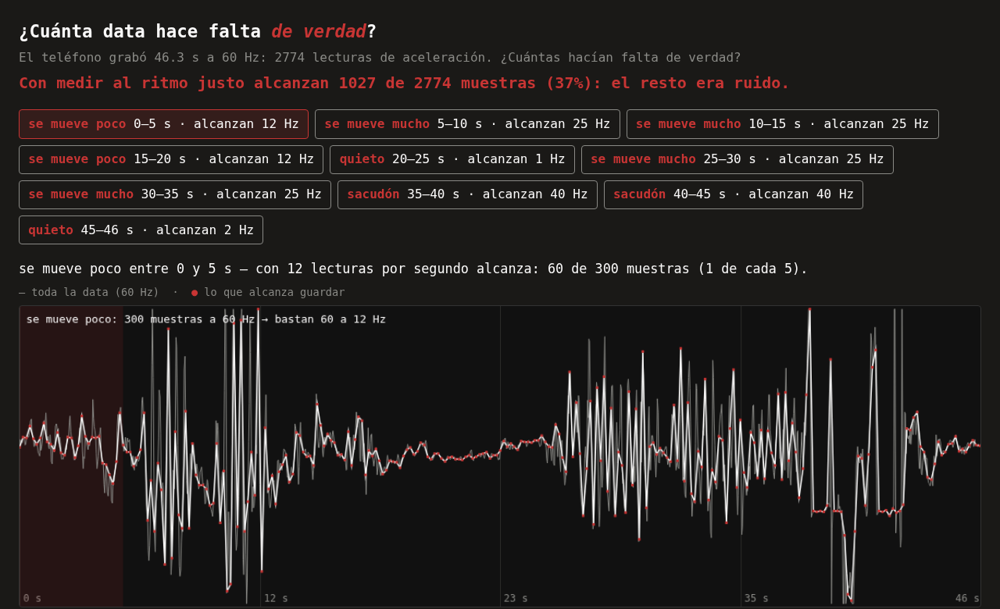

<!-- .slide: id="titulo" -->

# After Chatbon <!-- .element: class="fragment" -->

**PyDay Hurlingham**

**14 de Noviembre 2026**

[saxa.xyz/charla-after-chatbon](https://saxa.xyz/charla-after-chatbon/) <!-- .element: class="fragment" -->

---

<!-- .slide: data-transition="none" -->

### **[Phorma Scientific](https://phorma.sh)**

Sasha

Consultor independiente


--

- Física en la UBA
- Desarrollador de Software en **JP Morgan** *(Rates, CIB)*
- Lead Quant Developer en **Qontigo/Simcorp** *(Quantitative Pricing and Risk Analytics)*
- Líder Técnico en **Mercado Libre** *(IT Staff, Financial Planning & Analysis)*
- Senior AI Engineer en **AstraZeneca** *(R&D Oncology)*

--

No me gusta programar,

me gusta resolver problemas.
<!-- .element: class="fragment" -->

---

<!-- 01 Crua chan · El salto · ~1:00 -->

<div style="font-size: 0.55em; letter-spacing: 0.35em; color: #8a8a86;">AFTER CHATBON · LADO A · 01</div>

## “Come on London, here we come”

#### El salto

Producir código es más barato que nunca.
<!-- .element: class="fragment" -->

Adquirir la experiencia para dirigirlo, no. Esa sigue costando lo mismo: equivocarse de verdad.
<!-- .element: class="fragment" -->

NOTES:
Apertura fuerte. La IA reduce el costo de intentar cosas que antes eran caras o
inaccesibles. Esta charla no es anti-IA ni pro-IA: es sobre qué hacemos con esa
posibilidad. ~1 min.

---

<!-- 02 No tan distintos · ¿Cómo aprendemos? · ~2:00 -->

<div style="font-size: 0.55em; letter-spacing: 0.35em; color: #8a8a86;">AFTER CHATBON · LADO A · 02</div>

## “Do they know why they go?”

#### ¿Cómo aprendemos?

¿Qué proyecto tenés que no te animás a tocar?
<!-- .element: class="fragment" -->

¿Y cómo aprendiste lo que sabés?
<!-- .element: class="fragment" -->

<div style="font-size: 0.8em; color: #8a8a86;">

Probando. Rompiendo. Volviendo a probar.
<!-- .element: class="fragment" -->

</div>

NOTES:
Dos minutos de preguntas al público: proyectos que temen modificar,
experiencias aprendidas al equivocarse. Dejar que varios respondan antes de
avanzar. Los dos mensajes de la charla empiezan acá.

---

<!-- .slide: style="padding-top: 1.5vw" -->

<!-- 03 Banderitas y globos · El espectáculo · ~1:30 -->

<div style="font-size: 0.55em; letter-spacing: 0.35em; color: #8a8a86;">AFTER CHATBON · LADO A · 03</div>

## “lo entendido es lo que no entiendo”

#### El espectáculo

Demos espectaculares. Promesas de productividad. Todo automatizado.
<!-- .element: class="fragment" -->

¿Qué queda cuando termina el espectáculo?
<!-- .element: class="fragment" -->

La experiencia no se descarga. **Se construye.**
<!-- .element: class="fragment" -->

NOTES:
Contrapunto, no charla anti-IA: la pregunta no es si las promesas son
verdaderas o falsas, sino qué podemos hacer concretamente una vez que dejamos
de mirar el espectáculo. Necesitamos un ambiente donde experimentar sea barato,
seguro y reproducible: ese es el lab que viene ahora.

---

<!-- 04 Mañana en el Abasto · Un laboratorio en el bolsillo · ~2:00 -->

<div style="font-size: 0.55em; letter-spacing: 0.35em; color: #8a8a86;">AFTER CHATBON · LADO A · 04 · DEMO</div>

## “No tengas miedo, no”

#### Un laboratorio en el bolsillo

El teléfono graba aceleración a 60 Hz. 46 segundos en mi bolsillo:
**2774 lecturas**.
<!-- .element: class="fragment" -->

Todo empezó como un script de 20 líneas que leía el CSV.
<!-- .element: class="fragment" -->

--

```bash
uv run muestreo analizar datos/captura.csv
```

```text
     20.0-  25.0s   f_opt= 1  redundancia=90%
     40.1-  45.1s   f_opt=40  redundancia=44%

  data recomendada: 1027 de 2774 muestras (37%)
```
<!-- .element: class="fragment" -->

¿A 60 Hz la medición es mejor, o solo más grande?
<!-- .element: class="fragment" -->

NOTES:
Track 4 (~2:00). El teléfono es un laboratorio y sensor-log es la herramienta.
Demo NO en vivo: bloques crecientes con salidas capturadas de la captura real.
La pregunta que guía el resto: ¿a 60 Hz la medición es mejor, o solo más grande?

---

<!-- .slide: style="padding-top: 4vw" -->

<!-- 05 Hola Frank · Romper sin miedo · ~1:30 -->

<div style="font-size: 0.55em; letter-spacing: 0.35em; color: #8a8a86;">AFTER CHATBON · LADO A · 05 · DEMO</div>

## “Hello Frank, how’re you doing?”

#### Romper sin miedo

Quitar el **15** de `TASAS_BASE` → el test del contrato avisa en rojo.
<!-- .element: class="fragment" -->

`VENTANA_SUAVIZADO_S = 0.02` → el test de estabilidad avisa en rojo.
<!-- .element: class="fragment" -->

`git restore` → verde otra vez.
<!-- .element: class="fragment" -->

**Equivocarse cuesta un `git restore`.**
<!-- .element: class="fragment" -->

NOTES:
Track 5 (~1:30). La verdad conocida (señal sintética) es el oráculo; los tests
defienden lo que decidimos no negociar. Romper en vivo con el editor abierto,
mostrar el rojo, git restore.

---

<!-- .slide: style="padding-top: 9vw" -->

<!-- 06 Ojos de terciopelo · Entender el sistema · ~1:30 -->

<div style="font-size: 0.55em; letter-spacing: 0.35em; color: #8a8a86;">AFTER CHATBON · LADO A · 06 · DEMO</div>

## “Think it, don’t think it”

#### Entender el sistema

| qué pasaba | f_dyn | alcanzan | guardan |
|---|---|---|---|
| quieto | 0.8 Hz | 1 Hz | 5/300 |
| se mueve poco | 0.9 Hz | 12 Hz | 60/300 |
| se mueve mucho | 3 Hz | 25 Hz | 125/300 |
| sacudón | 5.5 Hz | 40 Hz | 200/300 |
<!-- .element: style="font-size: 0.64em;" -->

--

<div style="font-size: 1.6em; margin-top: 2rem;">

f<sub>opt</sub> ≈ k · f<sub>dyn</sub>

</div>

<div style="font-size: 1.1em; color: #8a8a86; margin-top: 1rem;">

f<sub>dyn</sub> = a<sub>max</sub> / (2π · v<sub>max</sub>)

</div>

NOTES:
Track 6 (~1:30). El punchline de Nyquist vs 4-8x vive ahora en el track 11
(acá no entraba: la tabla + el título de rincón llenan los 720px).
La regla salió de los datos, no de un libro: la métrica de
f_optima tomó 3 intentos (max-error y suavizado pareado sesgaban); la historia
de commits lo documenta — no "arreglar" sin leer. Con tasas discretas a veces
k se pasa del rango (13.6 en quieto): el grid de tasas cuantiza.

---

<!-- 07 Lo quiero ya · Cambio de lado · ~1:30 -->

<div style="font-size: 0.55em; letter-spacing: 0.35em; color: #8a8a86;">AFTER CHATBON · CAMBIO DE LADO · 07</div>

## “No sé lo que quiero, pero lo quiero ya”

#### Cambiamos de lado

¿Cuánto sabés de una medición mirando un JSON crudo?
<!-- .element: class="fragment" -->

Damos vuelta el disco: dejamos de construir el conocimiento —
empezamos a construir la forma de pensarlo.
<!-- .element: class="fragment" -->

NOTES:
Track 7 (~1:30). Mostrar salida/recomendacion.json un segundo: el JSON es el
contrato, el visor lo hace visible. El flip debe sentirse: acá ya no hablamos
de lo que la tecnología promete sino de lo que podemos hacer con ella.

---

<!-- 08 La gota en el ojo · Vanilla JS · ~1:30 -->

<div style="font-size: 0.55em; letter-spacing: 0.35em; color: #8a8a86;">AFTER CHATBON · LADO B · 08</div>

## “Sing the song today”

#### Vanilla JavaScript

Una SPA de un archivo. Sin framework.
<!-- .element: class="fragment" -->

```js
fetch("data/recomendacion.json")
```

El contrato es el JSON, no el framework.
<!-- .element: class="fragment" -->

NOTES:
Track 8 (~1:30). Lado B: construir el instrumento para pensar con lo que
construimos en el lado A. python3 -m http.server 8642 --directory visor.

---

<!-- .slide: style="padding-top: 9.5vw" -->

<!-- 09+10 El cieguito volador / No te pongas azul · Hacer visible e interactuar · ~2:00 -->

<div style="font-size: 0.55em; letter-spacing: 0.35em; color: #8a8a86;">AFTER CHATBON · LADO B · 09 + 10 · DEMO</div>

## “usan radar”

#### Hacer visible, interactuar y explorar



<div style="font-size: 0.66em; margin-top: 0.8rem;">

Click en *quieto*: con 1 lectura por segundo alcanza — y el gráfico era una línea plana.
<!-- .element: class="fragment" -->

Click en *sacudón*: recién con 40 Hz no miente.
<!-- .element: class="fragment" -->

**Son la misma historia.** Sin una línea de Python.
<!-- .element: class="fragment" -->

</div>

NOTES:
Tracks 9 y 10 fusionados (~2:00) para pagar el cierre comercial sin perder la
interacción: el 09 era solo la foto del visor, el 10 era el click. Se conserva el
número doble en el kicker para no romper los 12 tracks del disco.
Titular: con medir al ritmo justo alcanzan 1027 de 2774 muestras (37%), el resto
era ruido. Captura real, 46 s a 60 Hz. Recorrido: titular → chips en palabras
(quieto · se mueve poco · se mueve mucho · sacudón) → click en quieto (20–25 s)
→ click en sacudón (40–45 s). El visor traduce el contrato a palabras; el JSON no
cambia.

---

<!-- .slide: style="padding-top: 8.5vw" -->

<!-- 11 Noche de paz · Lo que no sabíamos · ~1:30 -->

<div style="font-size: 0.55em; letter-spacing: 0.35em; color: #8a8a86;">AFTER CHATBON · LADO B · 11</div>

## “Sueña un sueño imposible”

#### Lo que no sabíamos

Nyquist no alcanza: con 2× la señal existe, pero su forma miente.
<!-- .element: class="fragment" -->

La regla honesta (4–8×) salió de los datos, no de un libro.
<!-- .element: class="fragment" -->

Muestreo adaptativo: decirle a sensor-log qué rate usar en cada tramo
de una grabación real.
<!-- .element: class="fragment" -->

Esto es exactamente lo que hacemos en dos días con un equipo.
<!-- .element: class="fragment" -->

NOTES:
Track 11 (~1:30). El descubrimiento está codificado en un test: si la regla
dejara de sostenerse, el test avisa. La interacción sobre datos reales
reveló algo que no estaba en el diseño original.
El último fragment (~10 s) es el puente al cierre: decirlo con la prueba en
pantalla vale más que decirlo al final. Track 11 pasa a ~1:40.

---

<!-- 12 Percussion baby · El software como sustrato · ~2:00 -->

<div style="font-size: 0.55em; letter-spacing: 0.35em; color: #8a8a86;">AFTER CHATBON · LADO B · 12</div>

## “everyday is Sunday”

#### El software como sustrato

<div style="font-size: 0.6em; letter-spacing: 0.3em; color: #8a8a86;">MENSAJE 1</div>

La experiencia no se descarga. Se construye.
<!-- .element: class="fragment" -->

<div style="font-size: 0.6em; letter-spacing: 0.3em; color: #8a8a86;">MENSAJE 2</div>

El software es un sustrato para pensar.
<!-- .element: class="fragment" -->

--

¿Qué podrías aprender si tuvieras un lugar donde experimentar sin miedo a romper nada?
<!-- .element: class="fragment" -->

<div style="margin-top: 2rem; color: #8a8a86; font-size: 0.9em;">

El código puede cambiar. Las implementaciones pueden desaparecer.
Pero la experiencia y el conocimiento que construimos deberían acumularse.
<!-- .element: class="fragment" -->

</div>

NOTES:
Track 12 (~2:00). Cierre con energía, no con lista de consejos. Volver a los
dos mensajes explícitamente y terminar con la pregunta. Después, 8-10 minutos
de preguntas.

---

<div style="display: flex; flex-direction: column; align-items: center; justify-content: center; height: 100%;">

<div class="sumo-red" style="font-size: 1.5em; font-style: italic; font-weight: 700; text-align: center;">

Lo que no se codifica, se va con la persona

</div>

</div>

NOTES:
Bisagra (~0:20). Salir del track 12 y entrar al bloque de Phorma con la frase que
convierte el mensaje 2 en costo: el conocimiento que no queda escrito se va con el
que se va. Decirla y pasar, no explicarla.

---


### [Phorma Scientific](https://phorma.sh/es)

**Rigor. Rendimiento. Arquitectura.**

NOTES:
(~0:10) No leer el tagline: decir "esto es lo que hacemos con lo que acabamos de
ver". Una sola slide de logo (antes había dos idénticas seguidas).

--

### Dos días con tu equipo

Salís con un resultado que un colega puede reproducir desde una copia limpia.

<div style="font-size: 0.8em; margin-top: 0.8rem;">

Para laboratorios, cátedras y equipos de I+D:

— Código de investigación reproducible · 2 días

— Prácticas de testing · 2 días

— Liderando la adopción de IA · 1 día

</div>

<p style="margin-top: 0.6rem;">
<a href="https://phorma.sh/es/trainees" style="border-bottom: 2px solid;">phorma.sh/es/trainees</a>
</p>

NOTES:
(~0:45) Hablar SOLO la primera línea: el resultado verificable, no la lista. Los
tres cursos están en la slide para que cada uno se auto-identifique; el link lleva
al catálogo real con alcance y horarios. Nombres verificados contra
content/trainees/es/ del sitio de Phorma (83, 44, 75) — la slide anterior
prometía un "Diseño de Sistemas Cuantitativos" que no existe y llamaba "Rigor de
Producción (TDD, CI/CD)" a un curso que es de Git.
Límite honesto, decirlo en voz alta: esto no es una receta, el laboratorio se
diseña por proyecto.

--

### ¿Y ahora?

<div style="font-size: 0.85em; margin-top: 0.8rem;">

Tenés un proyecto que no te animás a tocar
<!-- .element: class="fragment" -->

→ **diagnóstico de una hora**, alcance fijo.
<!-- .element: class="fragment" -->

Estás estudiando
<!-- .element: class="fragment" -->

→ el código de esta demo está publicado: bajalo y rompelo.
<!-- .element: class="fragment" -->

</div>


NOTES:
(~0:30) Dos ramas porque la sala es mixta: quien tiene presupuesto y quien no.
Retomar textualmente la pregunta del track 02 ("¿qué proyecto tenés que no te
animás a tocar?") para cerrar el arco. La rama estudiante cuesta cero y es la
única que se puede ejecutar hoy mismo.
PENDIENTE DE DECISIÓN: si el diagnóstico de una hora es pago o bonificado — la
slide no dice precio a propósito; definir antes del ensayo del 13/11.
La URL corta es real: charla-after-chatbon/index.html redirige al deck.

---

> Una técnica que te sirve para escribir te tiene que servir también para vivir. O sea que si yo lo único que te voy a dar es tecniquería (sic), no sirve para nada.
— **Fabián Casas**

---

<!-- .slide: id="gracias" -->

# Gracias

[saxa.xyz/charla-after-chatbon](https://saxa.xyz/charla-after-chatbon)

[info@phorma.sh](mailto:info@phorma.sh)
