<!-- .slide: id="titulo" -->

## Software científico e IA: cómo usar LLMs sin romper todo

**PyDay La Plata**

**7 de Noviembre 2026**

[saxa.xyz/charla-scia](https://saxa.xyz/charla-scia)

---

<!-- .slide: data-transition="none" -->

### Sasha

Consultor independiente

**[Phorma Scientific](https://phorma.sh)**

--

- Estudié Física en la UBA
- Trabajé como Desarrollador de Software en **JP Morgan**
- Trabajé como Lead Quant Developer en **Qontigo/Simcorp** *(Quantitative Pricing and Risk Analytics)*
- Trabajé como Líder Técnico en **Mercado Libre** *(IT Staff, Financial Planning & Analysis)*
- Trabajé como Senior AI Engineer en **AstraZeneca** *(R&D Oncology)*

NOTES:
Acá tengo que mencionar un par de cosas de que me interesa y que motiva esta charla

--

No me gusta programar,

me gusta resolver problemas.
<!-- .element: class="fragment" -->

--

Los generadores (probabilísticos) de texto¹ son una gran ayuda.

<div style="font-size: 0.55em;">¹ Grandes Modelos de Lenguaje o LLMs</div>

---

<!-- 3	Presentación del problema	3 min -->

El Software Científico y su desarrollo tiene características muy distintas a los de una aplicación
comercial.

<div class="fragment">
<ul>
<li>Dinámico</li>
<li>Repetitivo</li>
<li>Experimental</li>
</ul>
</div>

--

<!-- .slide: id="script-inicial" -->

```py
from math import cos, radians, sin
import matplotlib.pyplot as plt

velocidad = 10  # m/s
angulo = radians(45)
GRAVEDAD = 10  # m/s²

vx = velocidad * cos(angulo)
vy = velocidad * sin(angulo)
duracion = 2 * vy / GRAVEDAD
t = [duracion * i / 100 for i in range(101)]
x = [vx * instante for instante in t]
y = [vy * instante - GRAVEDAD * instante**2 / 2 for instante in t]

plt.plot(x, y)
plt.savefig("trayectoria.png")
```

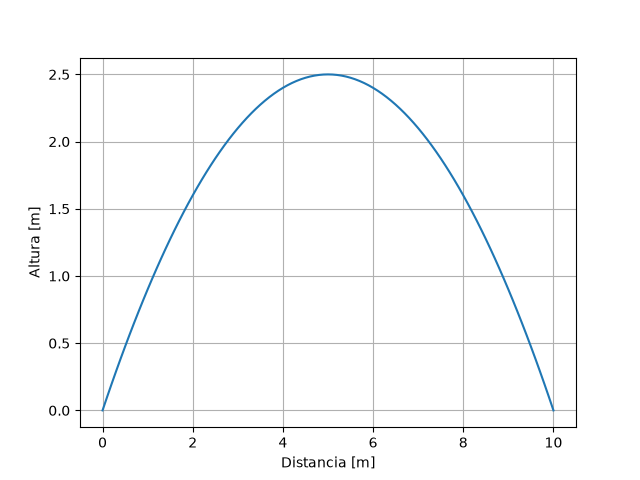

--

¿Cuáles son las prácticas de Ingeniería y Arquitectura de Software que podemos utilizar para mejorar nuestras herramientas?

--

### Artesanía de Software

> Prácticas y metodologías para producir artefactos de mejor calidad.
<!-- .element: class="fragment" -->

NOTES:
Importante mencionar la escala del software.

En investigación no conocemos todo el problema al empezar: hacemos un script para
responder una pregunta, vemos el resultado y aparecen nuevas preguntas. Con IA ese
ciclo se acelera muchísimo. La pregunta para la audiencia: ¿el software está
evolucionando junto con nuestra comprensión del problema, o solo acumulamos código?

---

<!-- 4	IA como herramienta	3 min -->

Cuando trabajamos con madera:
<!-- .element: class="fragment" -->

<div class="fragment">
<div style="display: grid; grid-template-columns: 1fr 1fr 1fr; gap: 1rem; align-items: center;">


</div>
</div>

> Serrucho -> Sierra Circular
<!-- .element: class="fragment" -->

Cuando trabajamos con software:
<!-- .element: class="fragment" -->

> Escribir código -> Generar código
<!-- .element: class="fragment" -->

NOTES:
Necesitamos mucho más control sobre lo que hacemos.

--

Lo que cambió es el sustrato sobre el que trabajamos:

> Madera -> Melamina/MDF
<!-- .element: class="fragment" -->

El sustrato es más uniforme, homogéneo, fácil de trabajar.
<!-- .element: class="fragment" -->

--

Al poder producir de manera probabilística el código,
necesitamos establecer protocolos, procedimientos que nos ayuden a
definir, elegir, evaluar, verificar lo que se produce.

NOTES:
En esta charla vamos a hablar de Regla y Escuadra y no de Serrucho y Martillo
No se trata de producir más código, necesitamos producir cosas de mayor calidad.

--

El valor del código es despreciable, es como el plástico, es algo descartable.

Lo que tiene valor es lo que produce.
<!-- .element: class="fragment" -->

En vez de crear un montón de cosas, tenemos que enfocarnos en mejorar la calidad.
<!-- .element: class="fragment" -->

--

<h2 style="color: #e53935;">WARNING</h2>

Los proveedores de tokens quieren que utilicemos sus herramientas lo más que se pueda, están diseñadas para ser adictivas.  <!-- .element: class="fragment" -->

Piensen en los Chats en los mismos términos que Facebook, Instagram, TikTok, X/Twitter.... <!-- .element: class="fragment" -->

- ¿Cuántas horas al día lo utilizan? <!-- .element: class="fragment" -->
- ¿Cuántas menos interacciones con otros seres humanos tienen? <!-- .element: class="fragment" -->
- ¿Qué información le están entregando? <!-- .element: class="fragment" -->

---

<!-- 5	Fricción: serialización	3 min -->

## Principios para describir un mejor software

--
Lo más importante es lograr un código bien modularizado, que nos permita
abstraer componentes.

<div class="fragment">
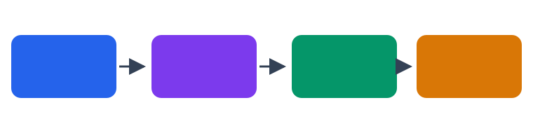
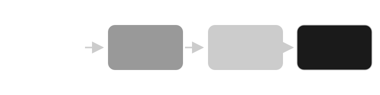
</div>

--

<!-- .slide: data-transition="none" -->

Lo más importante es lograr un código bien modularizado, que nos permita
abstraer componentes.


<div class="fragment">
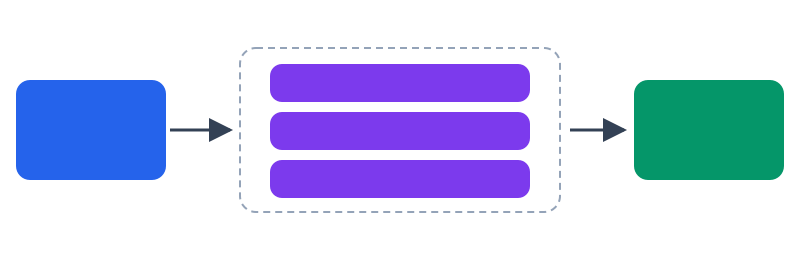
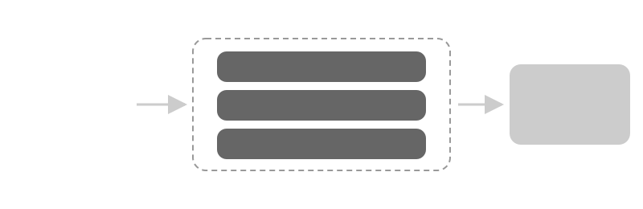
</div>

intercambiar un componente sin romper nada  <!-- .element: class="fragment" -->

--

```py
from math import cos, radians, sin
import matplotlib.pyplot as plt

velocidad = 10  # m/s
angulo = radians(45)
GRAVEDAD = 10  # m/s²

vx = velocidad * cos(angulo)
vy = velocidad * sin(angulo)
duracion = 2 * vy / GRAVEDAD
t = [duracion * i / 100 for i in range(101)]
x = [vx * instante for instante in t]
y = [vy * instante - GRAVEDAD * instante**2 / 2 for instante in t]

plt.plot(x, y)
plt.savefig("trayectoria.png")
```

Paso 1: Necesitamos registrar los inputs y los outputs
<!-- .element: class="fragment" -->

--

```py
from math import cos, radians, sin
import matplotlib.pyplot as plt

velocidad = 10  # m/s
angulo = radians(45)
GRAVEDAD = 10  # m/s²

vx = velocidad * cos(angulo)
vy = velocidad * sin(angulo)
duracion = 2 * vy / GRAVEDAD
t = [duracion * i / 100 for i in range(101)]
x = [vx * instante for instante in t]
y = [vy * instante - GRAVEDAD * instante**2 / 2 for instante in t]

plt.plot(x, y)
plt.savefig("trayectoria.png")
```

--

<!-- .slide: data-transition="none" -->

```py
from math import cos, radians, sin
import matplotlib.pyplot as plt
```

```py
velocidad = 10  # m/s
angulo = radians(45)
GRAVEDAD = 10  # m/s²

vx = velocidad * cos(angulo)
vy = velocidad * sin(angulo)
duracion = 2 * vy / GRAVEDAD
t = [duracion * i / 100 for i in range(101)]
x = [vx * instante for instante in t]
y = [vy * instante - GRAVEDAD * instante**2 / 2 for instante in t]

plt.plot(x, y)
plt.savefig("trayectoria.png")
```

--

<!-- .slide: data-transition="none" -->

```py
velocidad = 10  # m/s
angulo = radians(45)
GRAVEDAD = 10  # m/s²

vx = velocidad * cos(angulo)
vy = velocidad * sin(angulo)
duracion = 2 * vy / GRAVEDAD
t = [duracion * i / 100 for i in range(101)]
x = [vx * instante for instante in t]
y = [vy * instante - GRAVEDAD * instante**2 / 2 for instante in t]

plt.plot(x, y)
plt.savefig("trayectoria.png")
```

--

<!-- .slide: data-transition="none" -->

```py
velocidad = 10  # m/s
angulo = radians(45)
GRAVEDAD = 10  # m/s²
```

```py
vx = velocidad * cos(angulo)
vy = velocidad * sin(angulo)
duracion = 2 * vy / GRAVEDAD
t = [duracion * i / 100 for i in range(101)]
x = [vx * instante for instante in t]
y = [vy * instante - GRAVEDAD * instante**2 / 2 for instante in t]

plt.plot(x, y)
plt.savefig("trayectoria.png")
```

--

<!-- .slide: data-transition="none" -->

```py
velocidad = 10  # m/s
angulo = radians(45)
GRAVEDAD = 10  # m/s²
```

```py
vx = velocidad * cos(angulo)
vy = velocidad * sin(angulo)
duracion = 2 * vy / GRAVEDAD
t = [duracion * i / 100 for i in range(101)]
x = [vx * instante for instante in t]
y = [vy * instante - GRAVEDAD * instante**2 / 2 for instante in t]
```

```py
plt.plot(x, y)
plt.savefig("trayectoria.png")
```

--

<!-- .slide: data-transition="none" -->

```py
velocidad = 10  # m/s
angulo = radians(45)
GRAVEDAD = 10  # m/s²
```

```py
vx = velocidad * cos(angulo)
vy = velocidad * sin(angulo)
duracion = 2 * vy / GRAVEDAD
t = [duracion * i / 100 for i in range(101)]
x = [vx * instante for instante in t]
y = [vy * instante - GRAVEDAD * instante**2 / 2 for instante in t]
```

```py
resultado = {"x":x, "y": y}
```

--

<!-- .slide: data-transition="none" -->

```py
parametros = {"velocidad": 10, "angulo": 45 }

velocidad = parametros["velocidad"]
angulo = parametros["angulo"]
GRAVEDAD = 10  # m/s²
```

```py

angulo_rad = radians(angulo)
vx = velocidad * cos(angulo_rad)
vy = velocidad * sin(angulo_rad)
duracion = 2 * vy / GRAVEDAD
t = [duracion * i / 100 for i in range(101)]
x = [vx * instante for instante in t]
y = [vy * instante - GRAVEDAD * instante**2 / 2 for instante in t]


```

```py
resultado = {"x":x, "y": y}
```

--

<!-- .slide: data-transition="none" -->

```py
parametros = {"velocidad": 10, "angulo": 45 }

velocidad = parametros["velocidad"]
angulo = parametros["angulo"]
GRAVEDAD = 10  # m/s²
```

```py

angulo_rad = radians(angulo)
vx = velocidad * cos(angulo_rad)
vy = velocidad * sin(angulo_rad)
duracion = 2 * vy / GRAVEDAD
t = [duracion * i / 100 for i in range(101)]
x = [vx * instante for instante in t]
y = [vy * instante - GRAVEDAD * instante**2 / 2 for instante in t]
resultado = {"x":x, "y": y}


```

```py

```

--

<!-- .slide: data-transition="none" -->

```py
parametros = {"velocidad": 10, "angulo": 45 }

velocidad = parametros["velocidad"]
angulo = parametros["angulo"]
GRAVEDAD = 10  # m/s²
```

```py

    angulo_rad = radians(angulo)
    vx = velocidad * cos(angulo_rad)
    vy = velocidad * sin(angulo_rad)
    duracion = 2 * vy / GRAVEDAD
    t = [duracion * i / 100 for i in range(101)]
    x = [vx * instante for instante in t]
    y = [vy * instante - GRAVEDAD * instante**2 / 2 for instante in t]
    resultado = {"x":x, "y": y}


```

```py

```

--

<!-- .slide: data-transition="none" -->


```py
parametros = {"velocidad": 10, "angulo": 45 }

velocidad = parametros["velocidad"]
angulo = parametros["angulo"]
GRAVEDAD = 10  # m/s²
```

```py
def simular(velocidad, angulo):
    angulo_rad = radians(angulo)
    vx = velocidad * cos(angulo_rad)
    vy = velocidad * sin(angulo_rad)
    duracion = 2 * vy / GRAVEDAD
    t = [duracion * i / 100 for i in range(101)]
    x = [vx * instante for instante in t]
    y = [vy * instante - GRAVEDAD * instante**2 / 2 for instante in t]
    resultado = {"x":x, "y": y}
    return resultado
```

```py

```

--
<!-- .slide: data-transition="none" -->


```py
parametros = {"velocidad": 10, "angulo": 45 }

velocidad = parametros["velocidad"]
angulo = parametros["angulo"]
GRAVEDAD = 10  # m/s²
```

```py
def simular(velocidad, angulo):
    angulo_rad = radians(angulo)
    vx = velocidad * cos(angulo_rad)
    vy = velocidad * sin(angulo_rad)
    duracion = 2 * vy / GRAVEDAD
    t = [duracion * i / 100 for i in range(101)]
    x = [vx * instante for instante in t]
    y = [vy * instante - GRAVEDAD * instante**2 / 2 for instante in t]
    resultado = {"x":x, "y": y}
    return resultado
```

```py

```

--

<!-- .slide: data-transition="none" -->

```py
parametros = {"velocidad": 10, "angulo": 45 }

velocidad = parametros["velocidad"]
angulo = parametros["angulo"]
GRAVEDAD = 10  # m/s²
```

```py
def simular(velocidad, angulo):
    ...
```

```py

```

--

<!-- .slide: data-transition="none" -->

```py
parametros = {"velocidad": 10, "angulo": 45 }

velocidad = parametros["velocidad"]
angulo = parametros["angulo"]
GRAVEDAD = 10  # m/s²
```

```py
def simular(velocidad, angulo):
    ...
```

```py
resultado = simular(**parametros)
```

--

<!-- .slide: data-transition="none" -->

```py
parametros = {"velocidad": 10, "angulo": 45 }

GRAVEDAD = 10  # m/s²
```

```py
resultado = simular(**parametros)
```

```py
experimento = {"parametros":parametros, "resultado":resultado }
```

--

<!-- .slide: data-transition="none" -->

```
import json
```

```py
parametros = {"velocidad": 10, "angulo": 45 }

GRAVEDAD = 10  # m/s²
```

```py
resultado = simular(**parametros)
```

```py
experimento = {"parametros":parametros, "resultado":resultado }
```

--

<!-- .slide: data-transition="none" -->

```
import json
```

```py
parametros = {"velocidad": 10, "angulo": 45 }

GRAVEDAD = 10  # m/s²
```

```py
resultado = simular(**parametros)
```

```py
experimento = {"parametros":parametros, "resultado":resultado }
serializado = json.dumps(experimento)
```

--

<!-- .slide: data-transition="none" -->

```
import json
import Pathlib
```

```py
parametros = {"velocidad": 10, "angulo": 45 }
GRAVEDAD = 10  # m/s²
```

```py
resultado = simular(**parametros)
```

```py
experimento = {"parametros":parametros, "resultado":resultado }
serializado = json.dumps(experimento)
Path("experimento.json").write_text(serializado, encoding="utf-8")
```

Requerimos que nuestros componentes tengan inputs y outputs serializables.<!-- .element: class="fragment" -->

--

# REGLA 1

Requerimos que nuestros componentes tengan inputs y outputs serializables.

Este cambio en las restricciones que le imponemos a nuestro código nos permite pensar en nuestro sistema de manera modular y componible. <!-- .element: class="fragment" -->

---

<!-- 6	Diseño / Implementación / Verificación	4 min -->

Ahora que **delegamos** la implementación de los componentes. 

¿qué tenemos que hacer nosotros? <!-- .element: class="fragment" data-fragment-index="0" -->

<h5>
<span class="fragment" data-fragment-index="2">Diseño |</span>
<span class="fragment" data-fragment-index="1"> Implementación </span>
<span class="fragment" data-fragment-index="3">| Verificación</span>
</h5>

--


<h5>Diseño | Implementación | Verificación</h5>

<div style="position: relative; width: 65%; margin: 0 auto;">
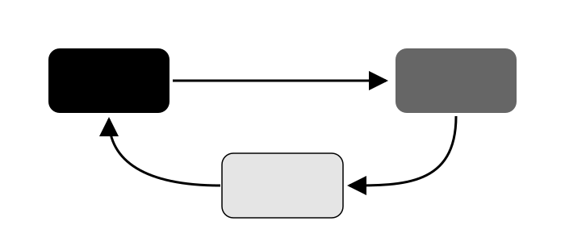
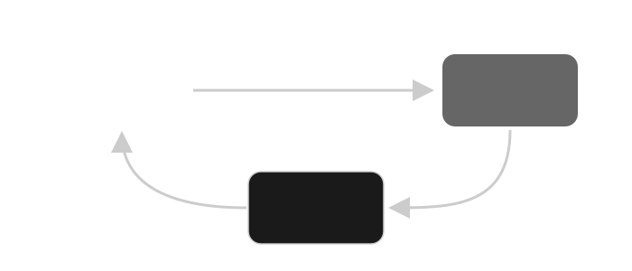
<div class="fragment" style="position: absolute; left: 7.5%; width: 85%; top: calc(52.3% - 3px); height: 6px; background: #e53935;">
<div style="position: absolute; right: -16px; top: -15px; width: 0; height: 0; border-top: 18px solid transparent; border-bottom: 18px solid transparent; border-left: 24px solid #e53935;"></div>
</div>
</div>

Tracer-bullet o bala trazadora:
<!-- esto deberia ser una definicion y ser un footnote -->

NOTES:

Tracer bullet

Lo que necesitamos es entender lo que un sistema hace, y poner restricciones.

Conversar, describir lo que queremos hacer, entender que tiene que pasar y cómo puede fallar.

Describirlo en lenguaje natural, o explicito como pruebas automáticas (tests) o propiedades.

Intención, Restricciones, Propiedades/Invariantes

--

## Pruebas Automáticas

También conocidas como "Tests"  <!-- .element: class="fragment" -->

NOTES:
Acá es donde el mayor valor del LLM aparece, en sintetizar el código para lo que queremos.
Pero las especificaciones en texto no son ejecutables, así que tenemos que construir la definición en algo ejecutable, que cada vez que cambiemos algo nos avise si rompimos algo.

--

```py
import pytest

from tiro_parabolico import simular


def test_lanzamiento_a_45_grados():
    salida = simular(velocidad=10, angulo=45)

    # Calculado a mano: alcance = v²·sen(2θ)/g = 10 m, altura = v²·sen²(θ)/(2g) = 2.5 m
    assert salida["x"][-1] == pytest.approx(10)
    assert max(salida["y"]) == pytest.approx(2.5)
    assert salida["y"][0] == pytest.approx(0)
    assert salida["y"][-1] == pytest.approx(0, abs=1e-12)
```

--

```py
@pytest.mark.parametrize("angulo, alcance", [
    (0, 0),
    (30, 5 * 3**0.5),
    (45, 10),
    (60, 5 * 3**0.5),
    (90, 0),
])
def test_alcances_conocidos(angulo, alcance):
    salida = simular(velocidad=10, angulo=angulo)
    assert salida["x"][-1] == pytest.approx(alcance, abs=1e-12)
```

--


```py
from hypothesis import given, strategies as st


@given(angulo=st.floats(min_value=1, max_value=89))
def test_angulos_complementarios_tienen_el_mismo_alcance(angulo):
    uno = simular(velocidad=10, angulo=angulo)
    otro = simular(velocidad=10, angulo=90 - angulo)
    assert uno["x"][-1] == pytest.approx(otro["x"][-1])
```


--

Verificación y Validación

¿cumple lo especificado? ≠ ¿la especificación es correcta?  <!-- .element: class="fragment" -->

un test verde puede ser dos códigos del mismo modelo coincidiendo entre sí  <!-- .element: class="fragment" -->

el caso a 45 grados es el oráculo: derivado a mano, independiente del código  <!-- .element: class="fragment" -->

NOTES:

Para validar y verificar podemos pedir que nos cree herramientas
que nos permitan visualizar los resultados

--

<div style="display: grid; grid-template-columns: 1.2fr 1fr; gap: 1.5rem; align-items: start; font-size: 0.8em;">
<div>
<h4>Trayectoria — Python en el navegador</h4>
<div id="tray-editor">
<pre id="tray-highlight" aria-hidden="true"><code class="hljs language-python"></code></pre>
<textarea id="tray-codigo" spellcheck="false" wrap="off"></textarea>
</div>
<p>
<button id="tray-boton" onclick="ejecutarPyodide('tray')">▶ Ejecutar</button>
<button onclick="restablecerTrayectoria()">↺ Restablecer</button>
<span id="tray-estado" style="color: #999;"></span>
</p>
</div>
<div>

<pre id="tray-salida" style="text-align: left; font-size: 0.5em;"></pre>
</div>
</div>

--

<div style="font-size: 0.8em;">
<h4>Resultados de las simulaciones</h4>
<p>
<input type="file" id="res-archivo" accept=".json,application/json">
<button id="res-boton" onclick="graficarResultado()">Graficar</button>
<span id="res-estado" style="color: #999;"></span>
</p>

</div>

---

<!-- 7	Extensión y evolución	3 min -->

--

```py
# computo de sensibilidades
```

--


--

<iframe width="560" height="315" src="https://www.youtube.com/embed/F8fBgDCf2Y4?si=KUeMyrdQTVIwb4Cf&amp;controls=0" title="YouTube video player" frameborder="0" allow="accelerometer; autoplay; clipboard-write; encrypted-media; gyroscope; picture-in-picture; web-share" referrerpolicy="strict-origin-when-cross-origin" allowfullscreen></iframe>

[Kent Beck: Software Engineering in the Age of AI](https://www.youtube.com/watch?v=F8fBgDCf2Y4)

--

```py
import json
import random
from pathlib import Path
from tiro_parabolico import simular

random.seed(42)  # experimento reproducible
experimentos = {"velocidad": [], "angulo": []}
for _ in range(1000):
    velocidad = random.gauss(10, 0.5)
    angulo = random.gauss(45, 2)
    experimentos["velocidad"].append({
        "entrada": {"velocidad": velocidad, "angulo": 45},
        "salida": simular(velocidad=velocidad, angulo=45),
    })
    experimentos["angulo"].append({
        "entrada": {"velocidad": 10, "angulo": angulo},
        "salida": simular(velocidad=10, angulo=angulo),
    })
Path("montecarlo.json").write_text(json.dumps(experimentos), encoding="utf-8")
```

--

```py
experimentos = json.loads(Path("montecarlo.json").read_text(encoding="utf-8"))
for nombre, lanzamientos in experimentos.items():
    nueva_figura(f"Monte Carlo variando {nombre}")
    for lanzamiento in lanzamientos:
        plt.plot(lanzamiento["salida"]["x"], lanzamiento["salida"]["y"], alpha=0.1)
    plt.savefig(f"montecarlo-{nombre}.png")
    plt.close()
```

--

```py
experimentos = json.loads(Path("montecarlo.json").read_text(encoding="utf-8"))
for nombre, lanzamientos in experimentos.items():
    nueva_figura(f"Monte Carlo variando {nombre}", xlabel=nombre,
                 ylabel="Distancia final [m]")
    plt.scatter(
        [lanzamiento["entrada"][nombre] for lanzamiento in lanzamientos],
        [lanzamiento["salida"]["x"][-1] for lanzamiento in lanzamientos],
        alpha=0.1,
    )
    plt.savefig(f"montecarlo-{nombre}-dispersion.png")
    plt.close()
```

--

```py
# paso extra sobre los datos guardados: distribución del alcance final
experimentos = json.loads(Path("montecarlo.json").read_text(encoding="utf-8"))
for nombre, lanzamientos in experimentos.items():
    nueva_figura(f"Monte Carlo variando {nombre}", xlabel="Distancia final [m]")
    alcances = [lanzamiento["salida"]["x"][-1] for lanzamiento in lanzamientos]
    plt.hist(alcances, bins=50)
    plt.axvline(mean(alcances), color="black")
    plt.savefig(f"montecarlo-{nombre}-distribucion.png")
    plt.close()
```

--

```py
# el formato único, reusado por 05, 06 y 07
def nueva_figura(titulo, xlabel="Distancia [m]", ylabel="Altura [m]"):
    plt.figure()
    plt.title(titulo)
    plt.xlabel(xlabel)
    plt.ylabel(ylabel)
```

los datos quedan en el registro; el ploting se reusa: un solo formato  <!-- .element: class="fragment" -->

los tres gráficos que vimos salieron de estas cinco líneas  <!-- .element: class="fragment" -->

--

<div style="display: grid; grid-template-columns: 1fr 1fr; gap: 1.5rem; align-items: center;">
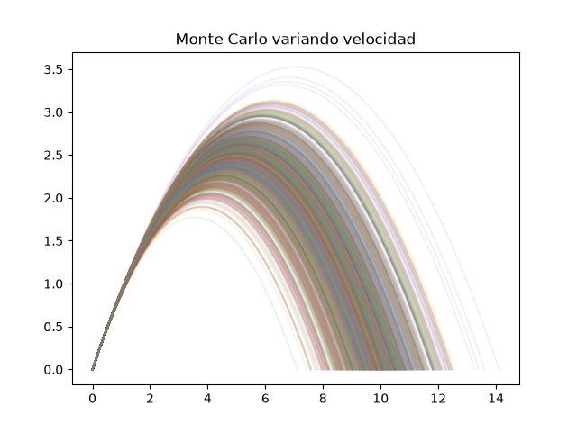
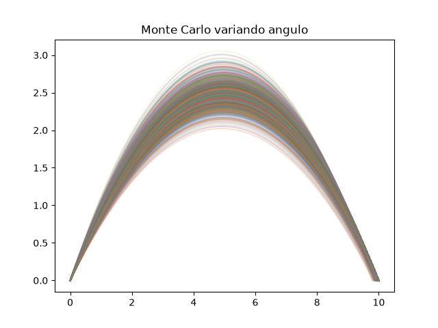
</div>

<p class="fragment" style="font-size: 0.7em;">velocidad: 8.39 a 11.76 m — angulo: 9.90 a 10.00 m</p>

<p class="fragment" style="font-size: 0.7em;">cerca de 45 grados, controlar la velocidad importa mucho más que el angulo</p>

--

<div style="display: grid; grid-template-columns: 1fr 1fr; gap: 1.5rem; align-items: center;">
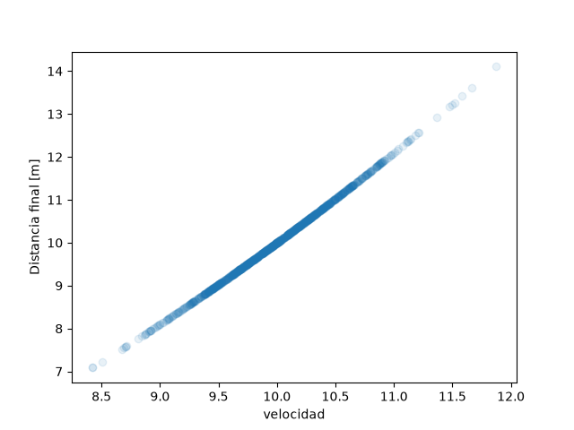
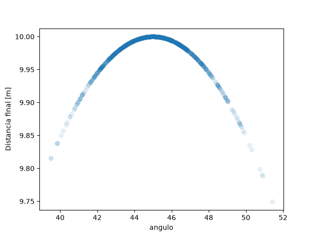
</div>

<p class="fragment" style="font-size: 0.7em;">correlación: +1.00 variando velocidad, -0.05 variando angulo</p>

<p class="fragment" style="font-size: 0.7em;">el scatter muestra el efecto: la nube de velocidad sube, la de angulo es plana</p>

--

<div style="display: grid; grid-template-columns: 1fr 1fr; gap: 1.5rem; align-items: center;">
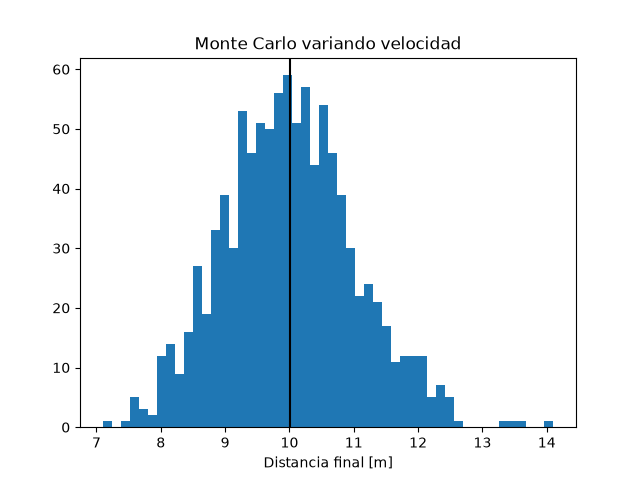
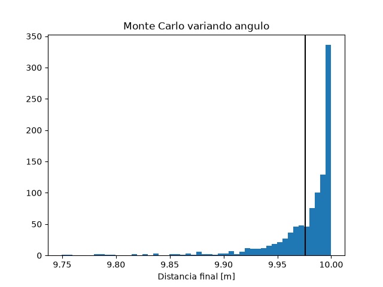
</div>

<p class="fragment" style="font-size: 0.7em;">velocidad: media 10.01 m, desviación estándar 1.02 m — angulo: media 9.98 m, desviación estándar 0.03 m</p>

<p class="fragment" style="font-size: 0.7em;">la desviación por velocidad es más de 30 veces la del angulo</p>

--

extender no siempre significa agregar funcionalidad

- el modelo: resistencia del aire y viento — con resistencia nula recuperamos el modelo ideal  <!-- .element: class="fragment" -->
- la implementación: python puro → numpy → optimizado — los tests siguen pasando  <!-- .element: class="fragment" -->
- el análisis: el Monte Carlo que acabamos de correr  <!-- .element: class="fragment" -->

--

crecer acumulando — el estilo clojure

lo que funciona no se modifica; lo nuevo se suma encima  <!-- .element: class="fragment" -->

```text
01_tiro_parabolico.py   el script original, sigue corriendo
02_inputs.py            agrega el registro de inputs
03_simular.py           agrega el registro de outputs
04_montecarlo.py        agrega el experimento
05_trayectorias.py      análisis: solo lee el registro
06_dispersion.py        análisis: solo lee el registro
07_distribucion.py      análisis: solo lee el registro
```
<!-- .element: class="fragment" -->

9 tests en verde — uno por etapa, ninguno descartado  <!-- .element: class="fragment" -->

NOTES:
El estilo clojure (Rich Hickey): desarrollo aditivo — funciones puras, datos
inmutables. Cada línea del listing existe hoy en el repositorio y funciona.
Las tres reglas están en el listing: lo viejo no se toca, lo nuevo se agrega,
el registro solo se lee. El detalle y los ejemplos están en el apéndice.

--

el diseño tiene que permitir cumplir la regla

el modelo no conoce el registro: puro, sin I/O, sin azar  <!-- .element: class="fragment" -->

el registro se escribe una vez; los análisis solo lo leen  <!-- .element: class="fragment" -->

--

¿cómo detectamos que el diseño sigue cumpliendo?

```sh
rg -n "json|random|write" tiro_parabolico.py
# sin resultados: el modelo no conoce la serialización
```
<!-- .element: class="fragment" -->

```sh
rg -n "montecarlo.json" 05_*.py 06_*.py 07_*.py
# tres lecturas, ninguna escritura
```
<!-- .element: class="fragment" -->

el test acumulado compara bytes: si el registro muta, falla  <!-- .element: class="fragment" -->

la fricción es el detector: si agregar un análisis obliga a tocar los anteriores, el diseño se rompió  <!-- .element: class="fragment" -->

--

"Revisemos que esto no sea YAGNI"  <!-- .element: class="fragment" -->

"No estamos haciendo sobre-ingenieria"  <!-- .element: class="fragment" -->

--

<span class="fragment" data-fragment-index="1">A</span>
<span class="fragment" data-fragment-index="0">B</span>

--

la IA acelera la implementación  <!-- .element: class="fragment" -->

el desafío: que la comprensión y el diseño acompañen esa velocidad  <!-- .element: class="fragment" -->

vale para simulaciones, análisis de datos y pipelines de investigación  <!-- .element: class="fragment" -->

---

<!-- 8	P.H.O.R.M.A.	2 min -->

- Probado (testado, validado) <!-- .element: class="fragment" -->
- Habitable (legible, human-friendly) <!-- .element: class="fragment" -->
- Operable (ejecuta en cualquier lugar) <!-- .element: class="fragment" -->
- Robusto (maneja fallas de manera correcta) <!-- .element: class="fragment" -->
- Mantenible (construido para durar) <!-- .element: class="fragment" -->
- <!-- .element: class="fragment" --> Auditable (transparente, rastreable/traceable)

--

<!-- .slide: data-transition="none" -->

- **P**robado (testado, validado)
- **H**abitable (legible, human-friendly)
- **O**perable (ejecuta en cualquier lugar)
- **R**obusto (maneja fallas de manera correcta)
- **M**antenible (construido para durar)
- **A**uditable (transparente, rastreable/traceable)

--

**P.H.O.R.M.A**

---

<!-- 9	Skill	2 min -->

### `scientific-tdd`

- **Diseño** — ¿qué estamos intentando representar?  <!-- .element: class="fragment" -->
- **Implementación** — ¿qué comportamiento debe tener el programa?  <!-- .element: class="fragment" -->
- **Verificación** — ¿qué sabemos sobre lo que construimos?  <!-- .element: class="fragment" -->

la serialización es la fricción que hace visibles esas preguntas  <!-- .element: class="fragment" -->

esta charla se construyó con ese mismo flujo  <!-- .element: class="fragment" -->

NOTES:
El skill combina tres actividades, cada una con su pregunta y su mecanismo de
fricción: diseño con serialización, implementación con TDD como especificación
ejecutable, y verificación contra oráculos independientes. El paso a paso de la
construcción va en el blog de Phorma. Dogfooding: las slides, los ejemplos y los
tests de esta charla se produjeron con este mismo flujo.

---

<!-- .slide: id="servicios" -->

## De la Teoría a la Práctica

Llevamos estos principios a tu código de producción.
<!-- .element: class="fragment" -->

--



### [Phorma Scientific](https://phorma.sh/es)

**Rigor. Rendimiento. Arquitectura.**

--

### [Phorma Scientific](https://phorma.sh/es)

**Rigor. Rendimiento. Arquitectura.**

<div style="font-size: 0.9em; margin-top: 2rem;">

— Auditoría de Sistema y Arquitectura

— Ingeniería de Software de Investigación (RSE)

— Machine Learning Científico (SciML)

— Síntesis de Rendimiento

</div>


--


### Capacitación Técnica

**Para laboratorios de investigación y equipos de I+D**

<div style="font-size: 0.9em; margin-top: 2rem;">

- Fundamentos de Computación Numérica
- Rigor de Producción (TDD, CI/CD)
- Machine Learning Científico
- Diseño de Sistemas Cuantitativos

</div>

<p style="margin-top: 2rem;">
<a href="https://phorma.sh/es/trainees" style="border-bottom: 2px solid;">phorma.sh/es/trainees</a>
</p>

--

> Una técnica que te sirve para escribir te tiene que servir también para vivir. O sea que si yo lo único que te voy a dar es tecniquería (sic), no sirve para nada.
— **Fabián Casas**

--

<div style="display: flex; flex-direction: column; align-items: center; justify-content: center; height: 100%;">

<div style="margin-top: 2rem; font-size: 1.2em;">

**[info@phorma.sh](mailto:info@phorma.sh)**

</div>

<p style="margin-top: 2rem; font-family: monospace; color: #666;">
Estructura sobre el Caos
</p>

</div>

---

<!-- .slide: id="gracias" -->

## Gracias

---

<!-- .slide: id="apendice" -->

## Apéndice — crecer acumulando

*Lo que vimos en la charla, con el detalle del repositorio.*

--

### La suite se acumula, no se reescribe

| etapa | tests que agregó | hoy |
|-------|------------------|-----|
| caso a 45 grados | +1 | en verde |
| parametrizados | +5 | en verde |
| propiedad (Hypothesis) | +1 | en verde |
| cadena de scripts 01→03 | +1 | en verde |
| cadena de Monte Carlo 04→07 | +1 | en verde |

uv run --locked pytest -q  <!-- .element: style="font-family: monospace; font-size: 0.7em;" -->

=9 passed=  <!-- .element: class="fragment" -->

ningún test fue descartado: cada etapa conserva los anteriores  <!-- .element: class="fragment" -->

--

### Función pura, registro inmutable

```py
def simular(velocidad, angulo):
    # sin I/O, sin estado, sin azar
    # mismas entradas → mismas salidas
```

04 escribe montecarlo.json una sola vez  <!-- .element: class="fragment" -->

05, 06 y 07 solo lo leen  <!-- .element: class="fragment" -->

el mismo registro responde preguntas distintas  <!-- .element: class="fragment" -->

--

### Un registro, tres análisis — y el que venga

04 guarda una vez: =montecarlo.json=

05 lee → trayectorias · 06 lee → dispersión · 07 lee → distribución  <!-- .element: class="fragment" -->

si mañana aparece otra pregunta, es un script más:  <!-- .element: class="fragment" -->

```py
alturas = [max(l["salida"]["y"])
           for l in experimentos["velocidad"]]
```

agregar un análisis no toca los existentes  <!-- .element: class="fragment" -->

--

### La garantía: reproducibilidad byte a byte

misma semilla → el mismo montecarlo.json  <!-- .element: class="fragment" -->

lo verifica el test de la cadena en una carpeta temporal  <!-- .element: class="fragment" -->

acumular sin romper necesita esta promesa  <!-- .element: class="fragment" -->

--

### Separar los datos del ploting

el registro guarda los datos; el ploting es código aparte que los lee  <!-- .element: class="fragment" -->

graficar sin recalcular: tres análisis sobre un solo montecarlo.json  <!-- .element: class="fragment" -->

<div class="fragment">
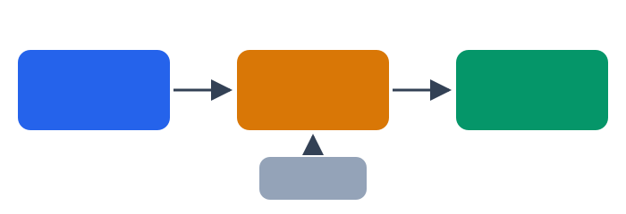
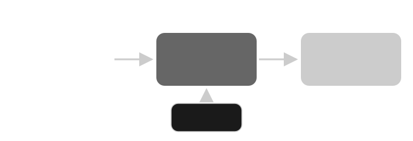
</div>

el formato único estandariza: mismas etiquetas en los tres gráficos  <!-- .element: class="fragment" -->

```py
nueva_figura(f"Monte Carlo variando {nombre}")
nueva_figura(f"Monte Carlo variando {nombre}", xlabel=nombre,
             ylabel="Distancia final [m]")
nueva_figura(f"Monte Carlo variando {nombre}", xlabel="Distancia final [m]")
```

---

<iframe width="560" height="315" src="https://www.youtube.com/embed/c5QF2HjHLSE?si=96Hcss0gU9AApBwv&amp;controls=0" title="YouTube video player" frameborder="0" allow="accelerometer; autoplay; clipboard-write; encrypted-media; gyroscope; picture-in-picture; web-share" referrerpolicy="strict-origin-when-cross-origin" allowfullscreen></iframe>

[Design In Practice](https://www.youtube.com/watch?v=c5QF2HjHLSE)

[WAI Decision Matrix](https://charly-vibes.github.io/wai/concepts/decision-matrix.html) <!-- .element: class="fragment" -->

--